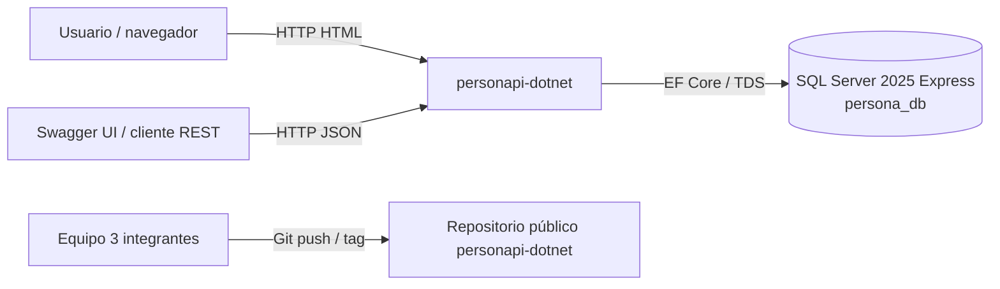
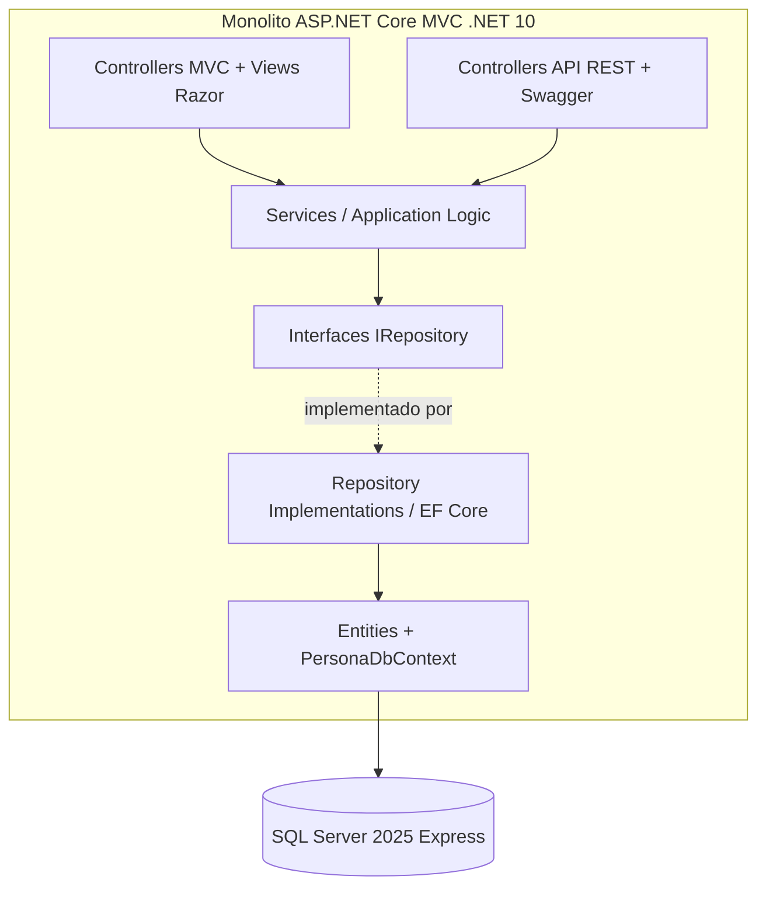
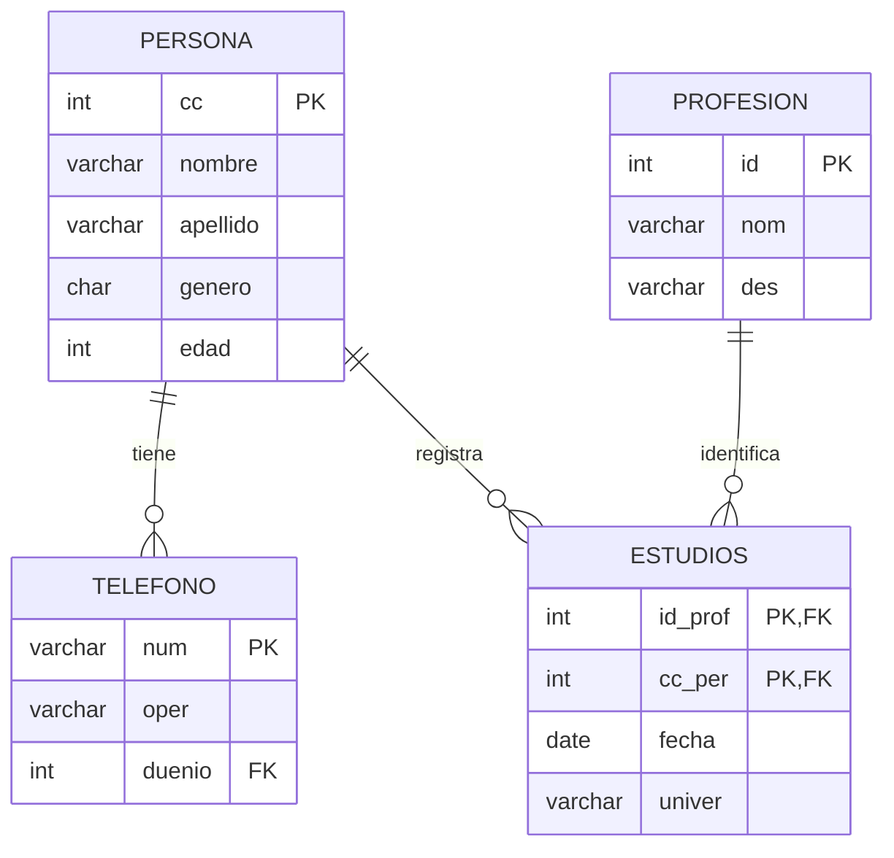
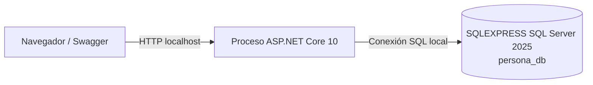

# SAD | Documento de arquitectura de software (HLD)

**Sistema:** `personapi-dotnet`  
**Nivel:** High-Level Design

> **Versión documental:** 2.0 | **Fecha:** 20-10-2026 | **Estado:** diseño aprobado como línea base de implementación, aún no implementado.  
> **Origen:** guía y diapositiva del Laboratorio 1; las versiones técnicas se actualizan por decisión del equipo.

## 1. Vista general
Sistema web monolítico ASP.NET Core MVC 10 con **dos interfaces de entrada**, vistas Razor y endpoints REST; ambas emplean los mismos servicios y DAO. Se ejecuta como un solo proceso web y accede a una base SQL Server 2025 Express `persona_db`.

## 2. Decisiones arquitectónicas definitivas
| ID | Decisión | Justificación / trade-off |
|---|---|---|
| AD-01 | Monolito de un proyecto ASP.NET Core MVC (.NET 10 LTS) | Corresponde al laboratorio; despliegue sencillo y llamadas internas. |
| AD-02 | Controladores separados MVC (HTML) y API (JSON) | Presentaciones diferentes, misma lógica de aplicación. |
| AD-03 | Servicios por entidad (`I*Service`) | Evita duplicar reglas entre canales; añade una capa pequeña pero deliberada. |
| AD-04 | DAO / Repository con interfaces e implementaciones EF Core 10 | Cumple DAO, habilita pruebas y desacopla persistencia. |
| AD-05 | SQL Server 2025 Express + Database First | Mantiene modelo entregado y genera entidades desde DDL. |
| AD-06 | PK/FK/CHECK y borrado `NO ACTION` | Evita registros inconsistentes. |
| AD-07 | OpenAPI 3 + Swagger UI integrado | Permite comprobar los 20 endpoints. |
| AD-08 | Ejecución local sin Docker ni autenticación | Ajusta alcance a práctica docente; sin publicación en Internet. |
| AD-09 | Configuración `ConnectionStrings:PersonaDb` externa y sin secretos en Git | Protege credenciales en repositorio público. |
| AD-10 | DTOs de entrada/salida y ViewModels de formularios | Evita exponer entidades EF y acoplar presentación al esquema. |

## 3. Contexto

## 4. Vista lógica y reglas de dependencia

**Reglas:** los controladores consumen `I*Service`, los servicios consumen `I*Repository`, solo implementaciones DAO acceden a `DbContext`. Servicios y controladores pueden utilizar DTOs; las vistas utilizan ViewModels. Las entidades generadas y el contexto representan persistencia, no reglas de aplicación.

## 5. Vista por módulos
| Módulo | Responsable conceptual | Datos |
|---|---|---|
| Personas | CRUD y restricciones de persona | `persona`, PK `cc` |
| Profesiones | CRUD y restricciones de profesión | `profesion`, PK `id` |
| Teléfonos | CRUD de teléfonos de una persona | `telefono`, FK `duenio` |
| Estudios | CRUD del vínculo persona-profesión | `estudios`, PK (`id_prof`,`cc_per`) |

**Paralelización:** con DDL y contratos estables, los cuatro módulos pueden avanzar por separado. Teléfonos/estudios requieren datos de referencia, no que las pantallas de otros módulos estén terminadas.

## 6. Arquitectura de datos

Se conserva la nomenclatura del esquema docente. Transformaciones MySQL→T-SQL: `ENUM('M','F')` a `CHAR(1)`+CHECK, `TEXT` a `VARCHAR(MAX)`, `INT(n)` a `INT`.

## 7. Vista de despliegue

Visual Studio 2026 Community / `dotnet run` hospedan el monolito. SQL Server 2025 Express se instala por separado; SSMS 22 administra el esquema. El proyecto no exige Docker y **no** distribuye SQL Server dentro del artefacto web.

## 8. Escenarios principales
**Crear teléfono:** usuario/REST → controlador → servicio valida `duenio` → DAO persiste → SQL Server → controlador devuelve vista/redirección o `201 Created`.

**Eliminar persona con estudios:** petición → servicio comprueba dependencias → resultado Conflict → REST `409` / MVC mensaje, sin modificar la base. Restricción FK también protege ante concurrencia.

**Consulta cruzada:** crear desde MVC, leer desde REST y viceversa confirma que comparten servicios y persistencia.

## 9. Drivers y respuestas arquitectónicas
| Driver SRS | Respuesta | Evidencia |
|---|---|---|
| DR-01 CRUD dual | AD-02/03 | Vistas y endpoints comparten servicio. |
| DR-02 MVC + DAO | AD-03/04 | Dependencias por interfaces. |
| DR-03 Monolito | AD-01/08 | Un proceso y un artefacto .NET. |
| DR-04 Relaciones | AD-05/06 | Restricciones de SQL, validaciones 409. |
| DR-05 Database First | AD-05 | Scaffolding documentado. |
| DR-06 Swagger | AD-07 | Documento OpenAPI con 20 operaciones. |
| DR-07 Reproducibilidad | AD-08/09 | README, DDL, DML, tag. |

## 10. Restricciones, amenazas y mitigación
- **Killer: lógica pegada a `DbContext` en controlador.** Revisar PR y estructura de dependencias.
- **Killer: llave compuesta mal resuelta.** Mapear ambos campos y probar DELETE/PUT por ruta doble.
- **Killer: datos huérfanos o borrados no autorizados.** FK + `NO ACTION` + `409`.
- **Killer: Swagger incompleto.** Contar 20 operaciones.
- **Killer: entorno irreproducible.** Ejecutar instalación desde clon limpio.
- **Sin autenticación:** demo local, no publicar servidor ni credenciales.

## 11. Decisiones cerradas y límites del SAD
Se adoptan .NET 10 LTS, EF Core 10, SQL Server 2025 Express, Visual Studio 2026 Community, SSMS 22, Swagger UI / OpenAPI 3, servicios, DAO, DTOs y despliegue local. No quedan alternativas técnicas por decidir en esta especificación; las pruebas posteriores determinarán si la implementación cumple esas decisiones.
