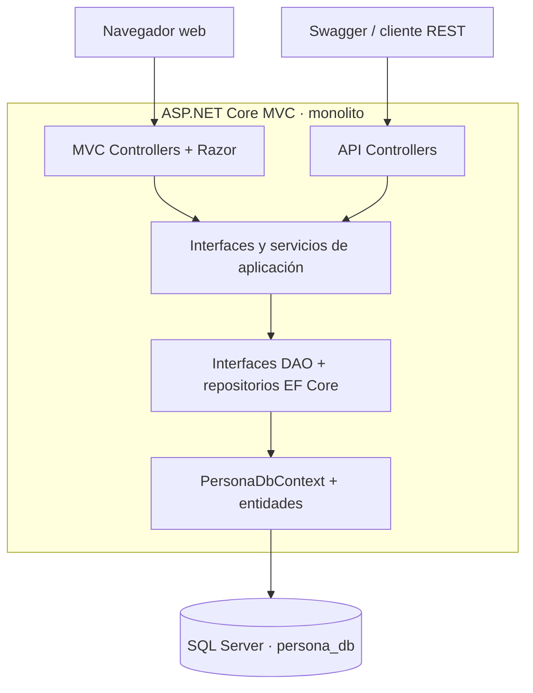
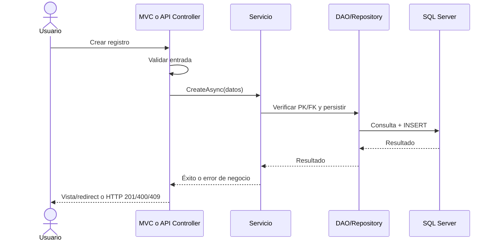

# Estilo y flujo end-to-end

[← Arquitectura](README.md)

## Diagrama lógico (HLD)

No hay llamadas de red entre capas internas: son invocaciones de código en el mismo proceso.

## Flujo principal CRUD

## Recorrido demostrable

Crear persona → crear profesión → asociar teléfono → asociar estudio → consultar por ambos canales → bloquear eliminación de persona con dependencias → eliminar dependientes → eliminar persona. Esto ejercita las cuatro tablas, reglas y capas.
