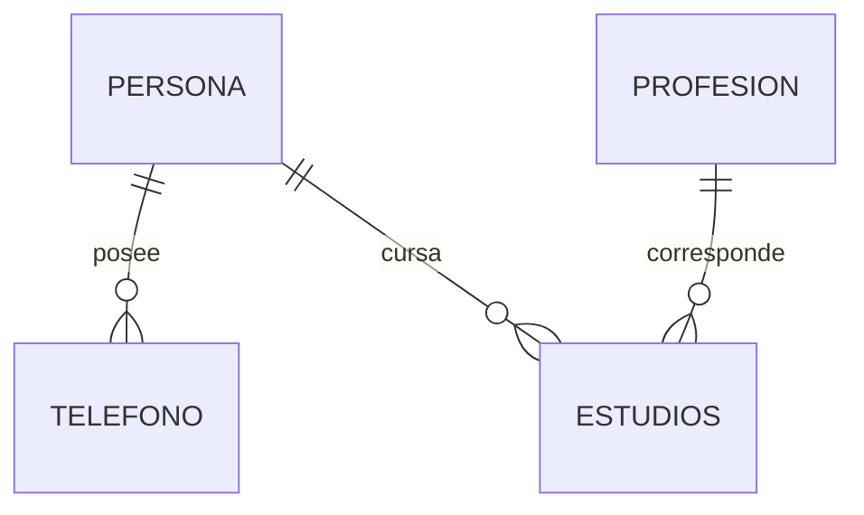

# Persistencia — SQL Server y Database First

[← Contratos](README.md) · [SAD/HLD](../02-arquitectura/02-SAD-HLD.md)

**Motor:** SQL Server 2025 Express. **Base:** `persona_db`. Una sola base compartida por los cuatro módulos del **mismo monolito**; no hay bases por servicio. Acceso mediante EF Core 10, a través de implementaciones DAO, sin SQL en controladores.

## Modelo físico

| Tabla | Clave primaria | Campos | Relaciones |
|---|---|---|---|
| `persona` | `cc INT` | `nombre VARCHAR(45)`, `apellido VARCHAR(45)`, `genero CHAR(1)`, `edad INT NULL` | Una persona tiene 0..N teléfonos y 0..N estudios |
| `profesion` | `id INT` | `nom VARCHAR(90)`, `des VARCHAR(MAX) NULL` | Una profesión tiene 0..N estudios |
| `telefono` | `num VARCHAR(15)` | `oper VARCHAR(45)`, `duenio INT` | `duenio` referencia `persona.cc` |
| `estudios` | `(id_prof INT, cc_per INT)` | `fecha DATE NULL`, `univer VARCHAR(50) NULL` | `id_prof` referencia `profesion.id`; `cc_per` referencia `persona.cc` |

La llave de `estudios` es **compuesta**; no se introduce un identificador artificial. `genero` utiliza `CHECK (genero IN ('M','F'))` para traducir el `ENUM` original. Las relaciones usan `NO ACTION`: nunca `CASCADE DELETE`. Un intento de eliminar persona o profesión con dependencias devuelve `409` desde la API y un mensaje útil en MVC.

## Esquema y datos

- `scripts/01_ddl.sql`: creación de `persona_db`, propietario `sa` según procedimiento docente, tablas, PK, FK y CHECK.
- `scripts/02_dml.sql`: datos mínimos de demostración reproducibles.
- En SQL Server, adaptar `ENUM` a `CHAR(1)+CHECK` y `TEXT` a `VARCHAR(MAX)`; `INT(n)` de MySQL pasa a `INT`.
- Definir scripts ejecutables en orden DDL → DML, sin credenciales embebidas.
- **Database First:** `Scaffold-DbContext` genera `Back/04-Persistencia/Entities/*` y `PersonaDbContext` a partir del esquema existente; se mantiene un único contexto por aplicación.
- Al modificar columnas o restricciones: actualizar script, regenerar/reconciliar modelos y adaptar DAO, servicios, DTO, pruebas y documentación juntos.

## Invariantes comprobables

1. No crear teléfono con persona inexistente, ni estudio con persona o profesión inexistente.
2. No duplicar cédula, identificador de profesión, teléfono o par `(id_prof, cc_per)`.
3. No borrar registros con dependencias que violen las FK.
4. CRUD desde Razor y REST consulta el **mismo** estado persistido.
5. Las credenciales se almacenan fuera del código fuente, usando configuración local y variables de entorno.

Fuente de verdad de columnas: DDL versionado. Este documento y [SDD](../04-implementacion/03-SDD-LDD.md) deben coincidir con él.
