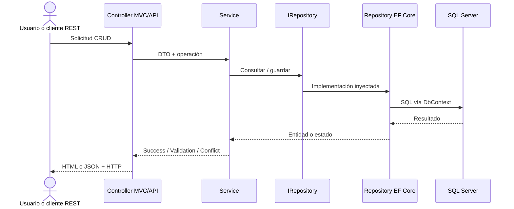

# SDD | Documento de diseño de software (LDD)

**Sistema:** `personapi-dotnet`  
**Nivel:** Low-Level Design

> **Versión documental:** 2.0 | **Fecha:** 20-10-2026 | **Estado:** diseño aprobado como línea base de implementación, aún no implementado.  
> **Origen:** guía y diapositiva del Laboratorio 1; las versiones técnicas se actualizan por decisión del equipo.

## 1. Dependencias y organización de código
- Target Framework: `net10.0`.
- ASP.NET Core MVC 10, EF Core 10 (`Microsoft.EntityFrameworkCore.SqlServer`, `.Design`, `.Tools`), Swashbuckle compatible para Swagger UI y OpenAPI 3.
- SQL Server 2025 Express, SSMS 22 y Visual Studio 2026 Community.
- Versión NuGet: usar versiones estables compatibles con .NET/EF Core 10 y registrar las versiones resueltas en el proyecto; no instalar pre-releases.

```text
personapi-dotnet/
├── README.md
├── personapi-dotnet.sln
├── scripts/
│   ├── 01_ddl.sql
│   └── 02_dml.sql
├── tests/
│   ├── Unit/
│   └── Integration/
└── personapi-dotnet/
    ├── Program.cs
    ├── appsettings.json
    ├── README.md                     # mapa de capas
    ├── Front/                        # lo que ve el navegador · Razor server-side
    │   ├── Views/
    │   │   ├── Shared/
    │   │   ├── Personas/
    │   │   ├── Profesiones/
    │   │   ├── Telefonos/
    │   │   └── Estudios/
    │   ├── wwwroot/                  #   CSS, JS, imágenes
    │   └── ViewModels/               #   contrato de Razor
    └── Back/                         # lógica · cuatro capas
        ├── 01-Borde/                 # CAPA 1 · único sitio que habla HTTP
        │   ├── Controllers/
        │   │   ├── PersonasController.cs
        │   │   ├── ProfesionesController.cs
        │   │   ├── TelefonosController.cs
        │   │   └── EstudiosController.cs
        │   ├── ControllersApi/
        │   │   ├── PersonasApiController.cs
        │   │   ├── ProfesionesApiController.cs
        │   │   ├── TelefonosApiController.cs
        │   │   └── EstudiosApiController.cs
        │   └── Dtos/                 #   contrato de REST
        ├── 02-Aplicacion/            # CAPA 2 · reglas de negocio
        │   └── Services/
        │       ├── Interfaces/
        │       └── Implementations/
        ├── 03-AccesoDatos/           # CAPA 3 · DAO, único sitio con EF Core
        │   └── Repository/
        │       ├── Interfaces/
        │       └── Implementations/
        └── 04-Persistencia/          # CAPA 4 · Database First
            └── Entities/             #   Scaffolded + PersonaDbContext
```

El árbol separa `Front/` de `Back/`. Dentro de `Back/` las carpetas están numeradas
por capa: una capa solo llama a la de número inmediatamente superior y **saltar capas
está prohibido**. Los controladores son **back**: no contienen HTML, entregan un
ViewModel en memoria a `Front/Views/`. `Front/` y `Back/` son carpetas, no despliegues:
sigue siendo un solo `.csproj` y un solo artefacto. Cada carpeta lleva su `README.md`
con reglas y prohibiciones. El árbol exige configurar `WebRootPath` y
`ViewLocationFormats` en `Program.cs`, y scaffolding con
`--output-dir Back/04-Persistencia/Entities`; ver
[estructura del repositorio](estructura-del-repositorio.md).

Las carpetas de primer nivel del proyecto están numeradas por capa: una capa solo
llama a la de número inmediatamente superior y **saltar capas está prohibido**. Cada
carpeta de capa lleva su `README.md` con reglas y prohibiciones. La numeración exige
configurar `WebRootPath` y `ViewLocationFormats` en `Program.cs`, y scaffolding con
`--output-dir 04-Persistencia/Entities`; ver
[estructura del repositorio](estructura-del-repositorio.md).

## 2. Contratos de aplicación y DAO
| Entidad | DAO | Servicio | Controladores |
|---|---|---|---|
| Persona | `IPersonaRepository`, `PersonaRepository` | `IPersonaService`, `PersonaService` | `PersonasController`, `PersonasApiController` |
| Profesion | `IProfesionRepository`, `ProfesionRepository` | `IProfesionService`, `ProfesionService` | `ProfesionesController`, `ProfesionesApiController` |
| Telefono | `ITelefonoRepository`, `TelefonoRepository` | `ITelefonoService`, `TelefonoService` | `TelefonosController`, `TelefonosApiController` |
| Estudio | `IEstudioRepository`, `EstudioRepository` | `IEstudioService`, `EstudioService` | `EstudiosController`, `EstudiosApiController` |

Contratos DAO asíncronos: `GetAllAsync()`, `GetByIdAsync(key)`, `ExistsAsync(key)`, `AddAsync(entity)`, `UpdateAsync(entity)`, `DeleteAsync(entity)`; para Estudios la clave es `(int idProf, int ccPer)`. Servicios exponen equivalentes con DTOs y resultados discriminados (`Success`, `NotFound`, `ValidationError`, `Conflict`). DAO concentra EF Core; servicio valida lógica de dominio. `DbContext` es scoped por solicitud.

## 3. DDL y Database First
Esquema `persona_db`:
- `persona(cc INT PK, nombre VARCHAR(45) NOT NULL, apellido VARCHAR(45) NOT NULL, genero CHAR(1) NOT NULL CHECK IN ('M','F'), edad INT NULL)`.
- `profesion(id INT PK, nom VARCHAR(90) NOT NULL, des VARCHAR(MAX) NULL)`.
- `telefono(num VARCHAR(15) PK, oper VARCHAR(45) NOT NULL, duenio INT NOT NULL FK → persona.cc)`.
- `estudios(id_prof INT NOT NULL FK → profesion.id, cc_per INT NOT NULL FK → persona.cc, fecha DATE NULL, univer VARCHAR(50) NULL, PK(id_prof, cc_per))`.

Las FKs usan `NO ACTION`. El script `01_ddl.sql` debe crear base/tablas/índices. `02_dml.sql` debe agregar datos idempotentes o instrucciones reproducibles claras. La propiedad de la base se asigna a `sa` cuando el laboratorio se ejecuta con autenticación SQL habilitada.

**Comandos de referencia** (en terminal ubicada en la carpeta del proyecto):
```bash
dotnet new sln -n personapi-dotnet
dotnet new mvc -n personapi-dotnet -f net10.0 --auth None
dotnet sln add personapi-dotnet/personapi-dotnet.csproj
dotnet add personapi-dotnet/personapi-dotnet.csproj package Microsoft.EntityFrameworkCore.SqlServer --version 10.*
dotnet add personapi-dotnet/personapi-dotnet.csproj package Microsoft.EntityFrameworkCore.Design --version 10.*
dotnet add personapi-dotnet/personapi-dotnet.csproj package Microsoft.EntityFrameworkCore.Tools --version 10.*
dotnet add personapi-dotnet/personapi-dotnet.csproj package Swashbuckle.AspNetCore
```
**Nota:** utilizar la versión estable resuelta más reciente de la rama mayor 10 para EF Core; guardar `csproj` y archivo de bloqueo si se configura restauración bloqueada. Evitar versiones de paquetes preview.

**Scaffolding** (con conexión integrada y `dotnet ef` alineado con EF Core 10):
```bash
dotnet ef dbcontext scaffold "Server=localhost\SQLEXPRESS;Database=persona_db;Trusted_Connection=True;TrustServerCertificate=True" Microsoft.EntityFrameworkCore.SqlServer --context PersonaDbContext --output-dir Back/04-Persistencia/Entities --no-onconfiguring
```

La conexión se define en `ConnectionStrings:PersonaDb` mediante configuración de desarrollo o User Secrets; nunca incluir contraseña real en `appsettings.json` versionado.

## 4. Dependencias en Program.cs
```csharp
builder.Services.AddControllersWithViews();
builder.Services.AddDbContext<PersonaDbContext>(options =>
    options.UseSqlServer(builder.Configuration.GetConnectionString("PersonaDb")));
builder.Services.AddScoped<IPersonaRepository, PersonaRepository>();
builder.Services.AddScoped<IProfesionRepository, ProfesionRepository>();
builder.Services.AddScoped<ITelefonoRepository, TelefonoRepository>();
builder.Services.AddScoped<IEstudioRepository, EstudioRepository>();
builder.Services.AddScoped<IPersonaService, PersonaService>();
builder.Services.AddScoped<IProfesionService, ProfesionService>();
builder.Services.AddScoped<ITelefonoService, TelefonoService>();
builder.Services.AddScoped<IEstudioService, EstudioService>();
```
Además: configurar `AddSwaggerGen`, `UseSwagger`, `UseSwaggerUI`, `MapControllers` para rutas por atributos y `MapControllerRoute` para vistas MVC. Los controladores API usan `[ApiController]`; los MVC heredan de `Controller`.

## 5. Contratos REST exactos (20 operaciones)
| Módulo | GET lista | GET detalle | POST | PUT | DELETE |
|---|---|---|---|---|---|
| Personas | `/api/personas` | `/api/personas/{cc}` | `/api/personas` | `/api/personas/{cc}` | `/api/personas/{cc}` |
| Profesiones | `/api/profesiones` | `/api/profesiones/{id}` | `/api/profesiones` | `/api/profesiones/{id}` | `/api/profesiones/{id}` |
| Teléfonos | `/api/telefonos` | `/api/telefonos/{num}` | `/api/telefonos` | `/api/telefonos/{num}` | `/api/telefonos/{num}` |
| Estudios | `/api/estudios` | `/api/estudios/{idProf}/{ccPer}` | `/api/estudios` | `/api/estudios/{idProf}/{ccPer}` | `/api/estudios/{idProf}/{ccPer}` |

**Códigos de estado:** GET encontrado `200`, POST creado `201` con `Location`, PUT/DELETE exitoso `204`, error de entrada `400`, registro ausente `404`, duplicidad/conflicto de dependencias `409`. Cuerpo y ruta deben coincidir en identificadores. Para estudios, actualización modifica `fecha`/`univer`, no cambia implícitamente la PK compuesta.

## 6. Vistas MVC y rutas
Para cada entidad crear cinco vistas Razor: `Index.cshtml` (GET listado), `Details.cshtml` (GET por clave), `Create.cshtml` (GET formulario/POST registro), `Edit.cshtml` (GET formulario/POST cambios) y `Delete.cshtml` (GET confirmación/POST eliminación). `Telefonos` usa selector de persona; `Estudios` usa selectores de persona y profesión. Mensajes de error visibles para validaciones y restricciones FK. Formularios POST con validación antiforgery de ASP.NET Core; no persistir si `ModelState` es inválido.

## 7. Reglas y validaciones por entidad
| Módulo | Reglas de escritura | Prueba negativa |
|---|---|---|
| Personas | `cc` única, nombre/apellido presentes, `genero` en M/F, edad nula o no negativa. | Borrar persona con estudios o teléfonos ⇒ 409. |
| Profesiones | `id` único; nombre obligatorio. | Borrar profesión asociada a estudios ⇒ 409. |
| Teléfonos | `num` único, longitud ≤15, `duenio` existente. | Crear teléfono con persona inexistente ⇒ 400. |
| Estudios | Persona/profesión existentes, PK compuesta única; fecha y universidad válidas cuando se provean. | Crear asociación duplicada ⇒ 409. |

## 8. Secuencia E2E


## 9. Comprobación de implementación
1. Restaurar y compilar `net10.0` sin errores.
2. Crear `persona_db`, ejecutar scripts y obtener clases scaffolded.
3. Inspeccionar dependencias: no hay consultas SQL/`DbContext` en controladores.
4. Probar cinco acciones por cuatro API; Swagger contiene 20 operaciones.
5. Probar cinco flujos web por entidad; los cambios son visibles vía REST.
6. Verificar `409` por dependencias, `400` por FK inválida y `404` por clave ausente.
7. Documentar configuración y compilación en README; verificar clon limpio.
8. Realizar `push` y crear `v1.0.0` únicamente después de validar la demo.

## 10. Cierre de diseño
Este LDD fija rutas, clases, estructura, patrones, versiones, reglas y despliegue local. **No hay elecciones arquitectónicas pendientes**. Los defectos encontrados durante desarrollo se registrarán como incidencias de implementación, no como decisiones de arquitectura abiertas. El backlog se definirá después.
