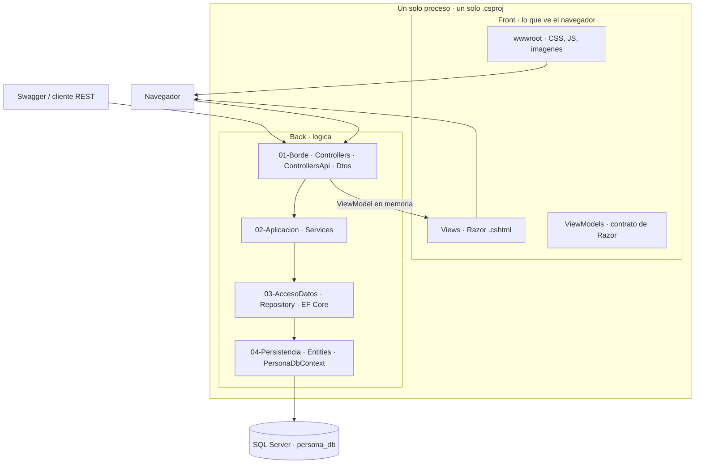

# personapi-dotnet · mapa de capas

Proyecto único ASP.NET Core MVC 10, un solo `.csproj`, un solo ejecutable. El árbol
separa **`Front/`** de **`Back/`**, y dentro de `Back/` las carpetas están numeradas
por capa: el número fija la posición en el flujo y la dirección permitida de las
llamadas.



## Front

Lo que termina en el navegador. **No es una aplicación aparte:** se renderiza en el
servidor, dentro del mismo ejecutable. Patrón: MVC server-side con Razor.

| Carpeta | Contenido |
|---|---|
| `Front/Views/` | Razor `.cshtml`, cuatro grupos CRUD y `Shared/` |
| `Front/wwwroot/` | CSS, JS, imágenes servidas al navegador |
| `Front/ViewModels/` | Contrato que consume Razor |

## Back

Todo lo que ejecuta lógica. Las cuatro carpetas son back.

| Nº | Carpeta | Contenido | Puede llamar a | Nunca toca |
|---|---|---|---|---|
| 01 | `Back/01-Borde/` | `Controllers` (MVC), `ControllersApi` (REST `/api/*`), `Dtos` | `02-Aplicacion` | `DbContext`, EF Core, SQL |
| 02 | `Back/02-Aplicacion/` | `Services`: reglas de negocio | `03-AccesoDatos` por interfaz | Razor, `HttpContext`, EF Core |
| 03 | `Back/03-AccesoDatos/` | `Repository`: DAO, único sitio con EF Core | `04-Persistencia` | HTTP, HTML, reglas de negocio |
| 04 | `Back/04-Persistencia/` | `Entities` + `PersonaDbContext` | SQL Server | Servicios, presentación |

**Prohibido saltar capas.** `01` no llama a `03` ni a `04`. Si una vista necesita un
dato, lo pide a un servicio, nunca a un repositorio.

## Por qué los Controllers son back y no front

`Back/01-Borde/Controllers/` no contiene ni una línea de HTML. Recibe la petición,
valida la entrada, llama a un servicio y entrega un **ViewModel** a `Front/Views/`,
que es quien produce el HTML. Por eso se llama *borde*: es la frontera donde el
sistema habla HTTP, el único sitio que conoce códigos de estado y binding.

`Dtos/` vive en el back porque es el contrato de la API REST, consumido por Swagger y
clientes externos. `ViewModels/` vive en el front porque solo lo consume Razor.

## Dos puertas, un solo cerebro

```text
Navegador       →  Back/01-Borde/Controllers/      ┐
                                                   ├→  02-Aplicacion → 03-AccesoDatos → 04-Persistencia → SQL Server
Swagger / REST  →  Back/01-Borde/ControllersApi/   ┘
```

Las vistas Razor **no** consumen `/api/*` por HTTP: reciben el ViewModel en memoria.
`/api/*` existe para Swagger y clientes REST. Son dos canales paralelos que bajan a
los mismos servicios, de modo que una regla de negocio se escribe **una sola vez**.

## Arquitectura: qué es y qué no es

Monolito **en capas con MVC + DAO**, decisión AD-01 del
[SAD](../docs/wiki/02-arquitectura/02-SAD-HLD.md).

No es onion, no es hexagonal y no es clean architecture. En esas el dominio ocupa el
centro, las dependencias apuntan hacia adentro mediante puertos y adaptadores, y el
dominio ignora el ORM. Aquí el flujo es lineal de `01` a `04` y las entidades de
`04-Persistencia` se generan por scaffolding EF Core (Database First). La separación
se logra con **interfaces** (`Services/Interfaces`, `Repository/Interfaces`), no con
inversión de dependencias del dominio.

`Front/` y `Back/` son **carpetas, no despliegues**: un solo artefacto, una sola base
`persona_db`. No hay microservicios ni SPA.

## Configuración obligatoria en `Program.cs`

Este árbol saca `Views/` y `wwwroot/` de las rutas que ASP.NET Core busca por
defecto. Sin la configuración siguiente, **las vistas devuelven 500 y los archivos
estáticos 404**. Corresponde a la issue de arranque del proyecto:

```csharp
var builder = WebApplication.CreateBuilder(new WebApplicationOptions
{
    Args = args,
    WebRootPath = "Front/wwwroot"
});

builder.Services.Configure<RazorViewEngineOptions>(o =>
{
    o.ViewLocationFormats.Clear();
    o.ViewLocationFormats.Add("/Front/Views/{1}/{0}" + RazorViewEngine.ViewExtension);
    o.ViewLocationFormats.Add("/Front/Views/Shared/{0}" + RazorViewEngine.ViewExtension);
});
```

Scaffolding EF Core:

```bash
dotnet ef dbcontext scaffold "<cadena-local-sin-credenciales>" \
  Microsoft.EntityFrameworkCore.SqlServer \
  --context PersonaDbContext --output-dir Back/04-Persistencia/Entities \
  --namespace personapi_dotnet.Back.Persistencia.Entities --no-onconfiguring
```

Sin `--namespace`, EF Core usa el nombre de la carpeta (`...Back.04-Persistencia.Entities`)
y la solución no compila. Ejecutado en HU-003; detalle en
[`Back/04-Persistencia`](Back/04-Persistencia/README.md).

**Verificado en HU-001** (SDK 10.0.402, `ASPNETCORE_ENVIRONMENT=Development`): con esta
configuración `/` responde 200 con la vista de `Front/Views/`, `/css/site.css` responde
200 desde `Front/wwwroot/` y `/swagger/v1/swagger.json` devuelve `"openapi": "3.0.4"`.

Dos consecuencias adicionales del árbol, también comprobadas:

- **Estáticos con `app.UseStaticFiles()`, no con `app.MapStaticAssets()`.** El manifiesto
  de `MapStaticAssets` se genera en compilación a partir de `./wwwroot`, carpeta que aquí
  no existe; `WebRootPath` solo actúa en ejecución. Con `MapStaticAssets` los estáticos
  quedan en 404.
- **Los namespaces no siguen el nombre de carpeta.** `01-Borde` y `04-Persistencia` no son
  identificadores válidos de C#, así que el código usa `personapi_dotnet.Back.Borde.*`,
  `personapi_dotnet.Back.Persistencia.*` y `personapi_dotnet.Front.ViewModels`. La carpeta
  conserva su número; solo cambia el namespace.

## Fuentes

[SAD](../docs/wiki/02-arquitectura/02-SAD-HLD.md) ·
[SDD](../docs/wiki/04-implementacion/03-SDD-LDD.md) ·
[estructura del repositorio](../docs/wiki/04-implementacion/estructura-del-repositorio.md) ·
[reglas arquitectónicas](../docs/wiki/02-arquitectura/reglas-arquitectonicas.md)
