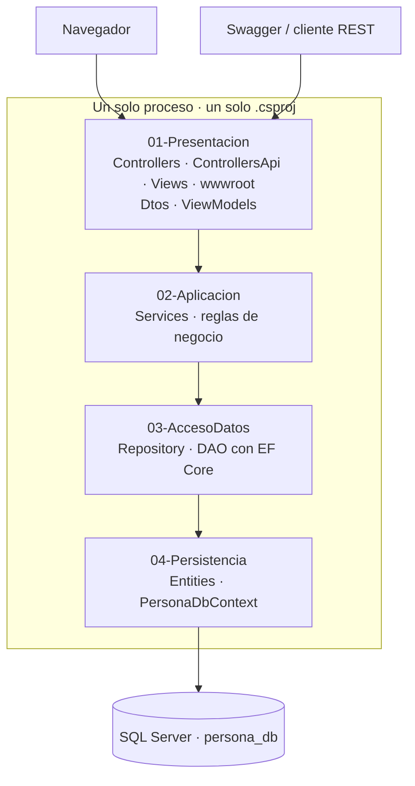

# personapi-dotnet · mapa de capas

Proyecto único ASP.NET Core MVC 10. Las carpetas de primer nivel están numeradas
por **capa**: el número indica la posición en el flujo y la dirección permitida de
las llamadas. Una capa solo puede llamar a la de número inmediatamente superior.



## Orden de capas

| Nº | Capa | Front/Back | Puede llamar a | Nunca toca |
|---|---|---|---|---|
| 01 | `01-Presentacion/` | Front + borde HTTP | `02-Aplicacion` | `DbContext`, EF Core, SQL |
| 02 | `02-Aplicacion/` | Back | `03-AccesoDatos` (por interfaz) | Razor, `HttpContext`, EF Core |
| 03 | `03-AccesoDatos/` | Back | `04-Persistencia` | HTTP, HTML, vistas |
| 04 | `04-Persistencia/` | Back | SQL Server | Servicios, presentación |

**Prohibido saltar capas.** `01` no puede llamar a `03` ni a `04`. Si una vista
necesita un dato, lo pide a un servicio, nunca a un repositorio.

## Qué es front y qué es back

El front **no** es una aplicación aparte. Es la capa `01`, renderizada en el
servidor con Razor, dentro del mismo ejecutable.

- **Front:** `01-Presentacion/Views/` (Razor `.cshtml`) y `01-Presentacion/wwwroot/`
  (CSS, JS, imágenes). Patrón: MVC server-side.
- **Back:** capas `02`, `03`, `04` más los controladores de `01` que exponen REST.
  Patrón: capas + DAO/Repository.

Las vistas Razor **no** consumen `/api/*` por HTTP. El controlador MVC les pasa un
ViewModel en memoria. `/api/*` existe para Swagger y clientes REST. Son dos puertas
paralelas que bajan a los mismos servicios de `02-Aplicacion`.

## Arquitectura: qué es y qué no es

Es un **monolito en capas con MVC + DAO** (decisión AD-01 del
[SAD](../docs/wiki/02-arquitectura/02-SAD-HLD.md)).

No es onion, no es hexagonal, no es clean architecture. En esas arquitecturas el
dominio ocupa el centro y las dependencias apuntan hacia adentro mediante puertos y
adaptadores, con el dominio ignorando por completo el ORM. Aquí el flujo es lineal
de `01` a `04` y las entidades de `04-Persistencia` provienen de scaffolding EF Core
(Database First). La separación se consigue con **interfaces**
(`Services/Interfaces`, `Repository/Interfaces`), no con inversión de dependencias
del dominio.

## Configuración obligatoria en `Program.cs`

Esta numeración saca `Views/` y `wwwroot/` de las rutas que ASP.NET Core busca por
defecto. Sin la configuración siguiente, **las vistas devuelven 500 y los archivos
estáticos devuelven 404**. Corresponde a la issue de arranque del proyecto:

```csharp
// wwwroot ya no está en la raíz del proyecto
var builder = WebApplication.CreateBuilder(new WebApplicationOptions
{
    Args = args,
    WebRootPath = "01-Presentacion/wwwroot"
});

// Views ya no está en la raíz del proyecto
builder.Services.Configure<RazorViewEngineOptions>(o =>
{
    o.ViewLocationFormats.Clear();
    o.ViewLocationFormats.Add("/01-Presentacion/Views/{1}/{0}" + RazorViewEngine.ViewExtension);
    o.ViewLocationFormats.Add("/01-Presentacion/Views/Shared/{0}" + RazorViewEngine.ViewExtension);
});
```

El scaffolding de EF Core también cambia de destino:

```bash
dotnet ef dbcontext scaffold "<cadena-local>" Microsoft.EntityFrameworkCore.SqlServer \
  --context PersonaDbContext --output-dir 04-Persistencia/Entities --no-onconfiguring
```

**Sin verificar.** No existe `Program.cs` ni `.csproj` todavía; estos fragmentos están
documentados, no ejecutados. La comprobación corresponde a la issue de arranque.

## Fuentes

[SAD](../docs/wiki/02-arquitectura/02-SAD-HLD.md) ·
[SDD](../docs/wiki/04-implementacion/03-SDD-LDD.md) ·
[estructura del repositorio](../docs/wiki/04-implementacion/estructura-del-repositorio.md) ·
[reglas arquitectónicas](../docs/wiki/02-arquitectura/reglas-arquitectonicas.md)
